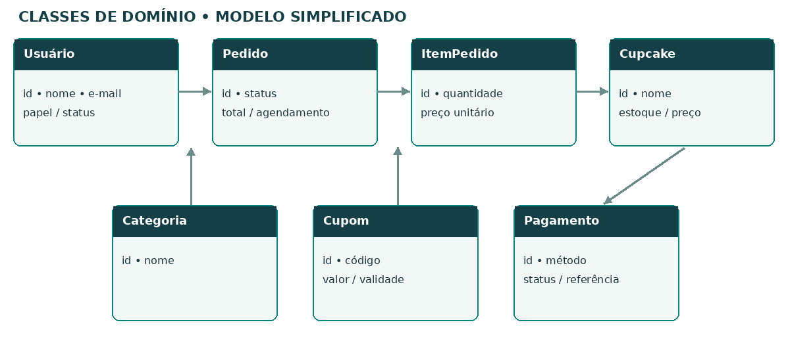
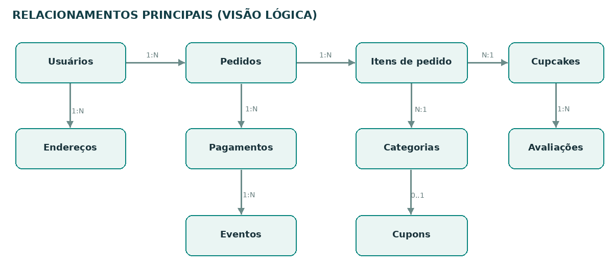

# Diagramas e protótipos da Le Cupcake

Os diagramas representam a estrutura e o funcionamento da versão 0.2 da aplicação. A descrição dos requisitos, das regras e dos testes consta na [documentação técnica](Documentacao%20do%20projeto.docx) e no [dicionário de dados](Dicionario%20de%20dados.docx).

## Casos de uso

## Classes do domínio

## Sequência do checkout

O checkout registra o pedido e reserva o estoque. As operações de pagamento demonstrativo ocorrem dentro da aplicação, sem comunicação com bancos ou gateways.

## Sequência de acompanhamento

O administrador registra a mudança de status. O cliente consulta o estado do pedido periodicamente e recebe avisos internos no sistema.

## Atividades do pedido

O cancelamento é permitido somente antes do início do preparo. Pagamentos simulados não representam transferência financeira.

## Modelo conceitual e relacionamentos

O esquema SQLite possui 23 tabelas na estrutura inicial e 27 tabelas após as sete migrações. A descrição de atributos e relações está no dicionário de dados.

## Protótipos de interface

### Catálogo

### Carrinho

### Administração

Os protótipos são representações esquemáticas da interface. As comparações das versões 0.1 e 0.2 estão no [laudo de qualidade](Laudo%20de%20qualidade.pdf).
