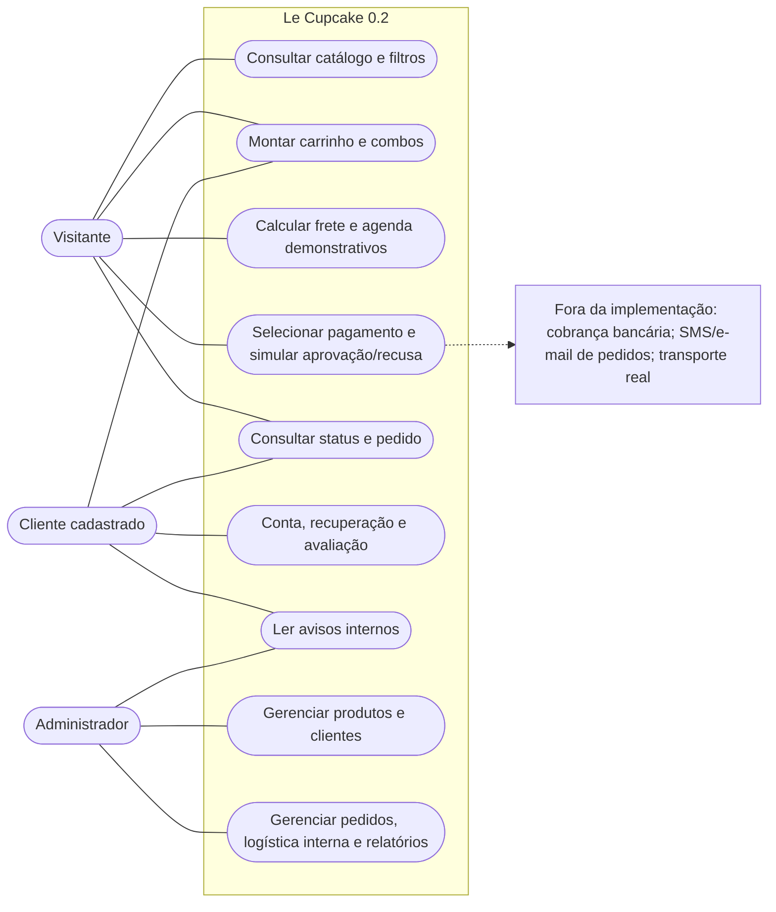
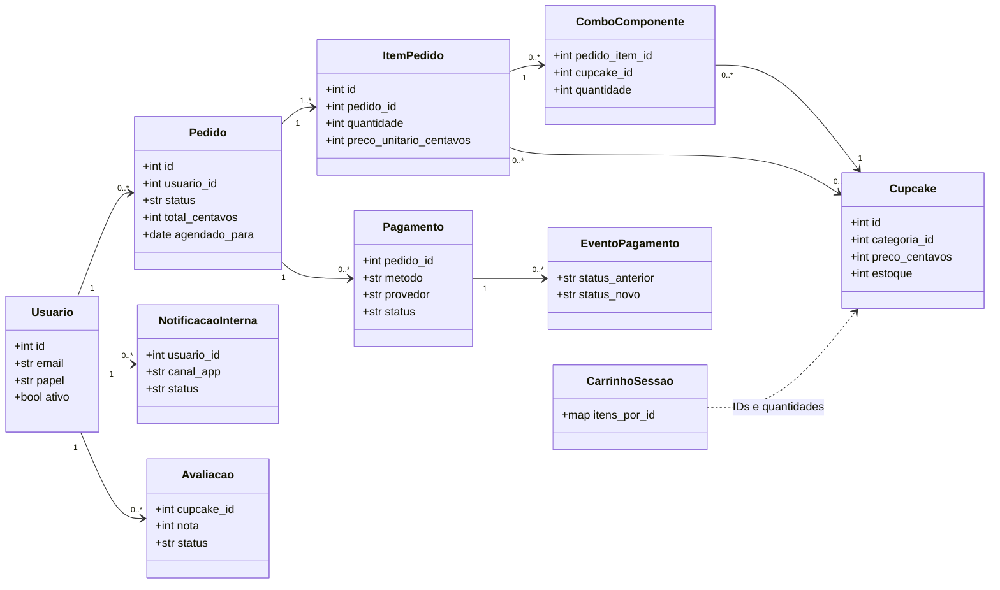
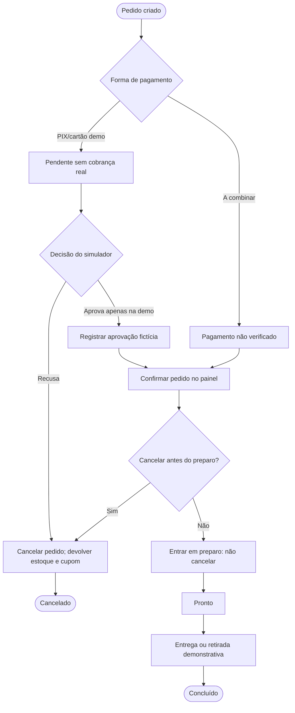
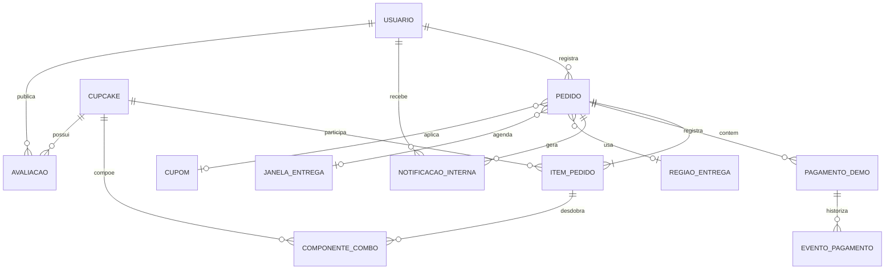
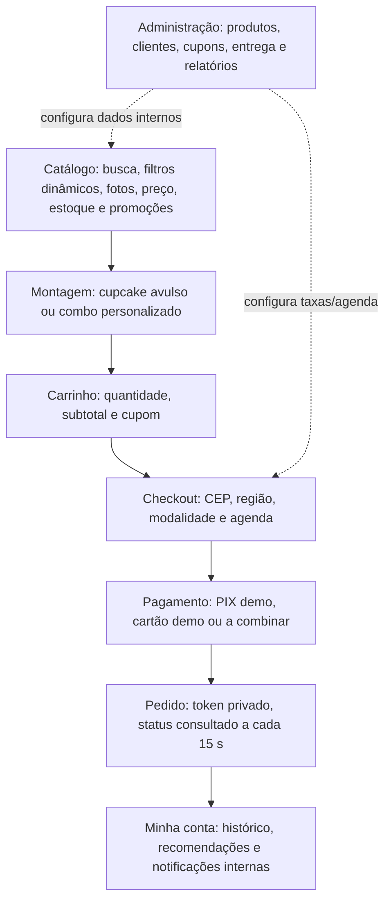

# Le Cupcake — Documentação do projeto

## 1. Apresentação

O Le Cupcake é uma aplicação acadêmica de loja virtual de cupcakes desenvolvida no Projeto Integrador Transdisciplinar em Engenharia de Software II. O planejamento original da PIT I contém 25 histórias de usuário. A implementação inicial, denominada versão 0.1, foi apresentada em vídeo e acompanhada de cinco avaliações. A revisão dessas avaliações e dos requisitos originalmente planejados orientou a ampliação para a versão 0.2.

A versão 0.2 está integrada à branch principal do repositório e publicada em https://le-cupcake.onrender.com/. O código foi desenvolvido em Python/FastAPI, com interface HTML, CSS e JavaScript, templates Jinja2 e banco SQLite.

## 2. Funcionalidades implementadas

O catálogo oferece pesquisa, filtros por categoria, preços, imagens, controle de disponibilidade e promoções. O carrinho permite alterar quantidades e selecionar produtos avulsos ou combos personalizados, com conferência de estoque no servidor.

O checkout demonstra opções de retirada ou entrega, taxas calculadas por faixas de CEP cadastradas, agendamento e pagamento simulado. A área do cliente reúne pedidos, histórico, recomendações por categorias de compras anteriores e avaliações. O painel administrativo dispõe de gestão de produtos, arquivamento condicionado, auditoria, estoque, pedidos, cupons, clientes, configurações de entrega e relatórios.

As melhorias de navegação e apresentação foram examinadas após as avaliações. As funções adicionais também decorrem da revisão das histórias da PIT I; esses dois tipos de melhoria foram considerados separadamente.

### Correspondência com as histórias da PIT I

| História | Descrição | Implementação na versão 0.2 |
|---|---|---|
| US-01 | Catálogo, imagens e estoque | Núcleo disponível; desempenho externo não comprovado |
| US-02 | Filtros dinâmicos | Núcleo disponível; tempo de resposta no Render não medido |
| US-03 | Carrinho | Núcleo disponível; RNF não medido |
| US-04 | Frete e total | Demonstrativo, taxa por CEP; sem transportadora |
| US-05 | Recebimento | Demonstrativo, entrega e retirada; sem logística real |
| US-06 | Acompanhar pedido | Parcial, polling 15 s; não push |
| US-07 | Conta de cliente | Parcial, reset depende de SMTP externo |
| US-08 | Recomendações | Núcleo por histórico; RNF não medido |
| US-09 | Promoções e cupons | Núcleo disponível; RNF não medido |
| US-10 | Avaliações | Núcleo disponível; moderação com autenticação e testes HTTP |
| US-11 | Avisos a clientes | Parcial, só notificações internas |
| US-12 | Meios de pagamento | Apenas simulação interna, sem transações reais |
| US-13 | Agendamento | Demonstrativo, sem logística real |
| US-14 | Combos | Núcleo disponível, estoque validado localmente |
| US-15 | Nutrição/alergênicos | Parcial, dados reais não verificados |
| US-16 | Cadastrar produtos | Núcleo disponível; sem certificação formal de desempenho |
| US-17 | Editar e excluir produtos | Núcleo disponível, arquivamento lógico; sem certificação formal de desempenho |
| US-18 | Relatórios | Núcleo demonstrativo, pedidos não receita recebida |
| US-19 | Gestão em tempo real | Parcial, polling sem push nem carga comprovada |
| US-20 | Gerenciar promoções | Núcleo disponível; sem certificação formal de desempenho |
| US-21 | Avisos a administradores | Parcial, só notificações internas |
| US-22 | Contas de clientes no admin | Núcleo disponível; sem certificação formal de desempenho |
| US-23 | Respostas a avaliações | Núcleo disponível; resposta e moderação administrativa disponíveis |
| US-24 | Configurar entrega/retirada | Demonstrativo, sem logística real |
| US-25 | Gateway online | Não implementado externamente |

Os recursos demonstrativos não representam serviços externos contratados. Os testes automatizados verificam os fluxos cobertos, sem medir formalmente requisitos de desempenho em grande escala.

## 3. Tecnologias e banco de dados

A aplicação utiliza Python 3.11+, FastAPI, Jinja2, HTML, CSS, JavaScript, Pytest e SQLite. O carrinho operacional é mantido em sessão assinada. Pedidos, itens, pagamentos demonstrativos, eventos e notificações internas são registrados no banco.

O esquema-base define 23 tabelas. As migrações 1–7 completam o banco com **27 tabelas, 173 colunas, 34 chaves estrangeiras e 20 índices nomeados**. Os valores monetários são representados em centavos. A integridade referencial foi verificada na base de testes.

A descrição de todas as tabelas e de seus campos está disponível no [dicionário de dados](Dicionario%20de%20dados.docx).

## 4. Modelagem do sistema

Os diagramas a seguir representam os principais atores, entidades e fluxos da versão publicada. Os modelos são esquemáticos e complementam as estruturas do banco.

### Casos de uso



### Classes do domínio



### Sequência da finalização do pedido

```mermaid
sequenceDiagram
  autonumber
  actor Cliente
  participant Site as FastAPI / checkout
  participant DB as SQLite (transação)
  participant Demo as Simulador local
  Cliente->>Site: Enviar cesta, CEP, agendamento, cupom, método
  Site->>Site: CSRF, dados, estoque, capacidade e preço
  Site->>DB: Criar pedido/itens; reservar estoque; pagamento pendente
  DB-->>Site: Pedido e link privado
  Site-->>Cliente: Exibir pedido (nenhuma cobrança real)
  alt PIX ou cartão demonstrativo
    Cliente->>Site: Aprovar ou recusar simulação
    Site->>DB: Iniciar transação; validar pagamento e estado
    Site->>Demo: Decisão somente local
    alt Aprovado localmente
      Demo-->>Site: aprovado somente no simulador
      Site->>DB: Registrar evento demonstrativo
    else Recusado localmente
      Demo-->>Site: recusado somente no simulador
      Site->>DB: Cancelar pedido, devolver estoque e cupom uma vez
    end
    DB-->>Cliente: Novo estado no acompanhamento
  else A combinar
    Site-->>Cliente: Pagamento não verificado
  end
```

### Sequência de acompanhamento

```mermaid
sequenceDiagram
  autonumber
  actor Admin as Administrador
  participant API as FastAPI
  participant DB as SQLite
  actor Cliente
  Admin->>API: Solicita nova etapa com CSRF
  API->>DB: BEGIN IMMEDIATE; conferir transição e registrar evento
  DB->>DB: Criar notificação interna, canal=app
  DB-->>API: Status atualizado
  API-->>Admin: Confirmação da operação
  loop Cada 15 segundos
    Cliente->>API: GET /api/pedido/{token}/status
    API->>DB: Consultar estado e previsão
    DB-->>API: Status e previsão cadastrada
    API-->>Cliente: Exibir etapa atual
  end
  Cliente->>API: Ler notificações em Minha conta
  API-->>Cliente: Mensagens internas
```

### Atividades do pedido



### Modelo conceitual



### Relações do modelo físico

```text
agenda_bloqueios      alergenos             auditoria
avaliacoes             carrinho_itens         carrinhos
categorias             combo_itens            combos
cupcake_alergenos      cupcakes               cupom_utilizacoes
cupons                 enderecos              estoque_movimentos
eventos_pedido         janelas_entrega        notificacoes
opcoes_entrega         pagamento_eventos      pagamentos
password_reset_tokens  pedido_combo_componentes
pedido_itens           pedidos                regioes_entrega
usuarios
```

### Fluxos de interface




### Diagramas e protótipos gráficos

- [Casos de uso](diagramas/Casos%20de%20uso.png)
- [Classes](diagramas/Classes.png)
- [Relacionamentos](diagramas/Relacionamentos.png)
- [Protótipo do catálogo](diagramas/Prototipo%20do%20catalogo.png)
- [Protótipo do carrinho](diagramas/Prototipo%20do%20carrinho.png)
- [Protótipo da administração](diagramas/Prototipo%20da%20administracao.png)

Essas imagens representam a modelagem e a interface projetada. As comparações visuais entre as versões 0.1 e 0.2 constam no laudo de qualidade.

## 5. Testes e resultados

A suíte automatizada de referência foi executada com Pytest, HTTPX, FastAPI TestClient e banco SQLite de teste, concluindo **93 testes aprovados**. Foram verificados catálogo, autenticação, pedidos, permissões, checkout, estoque, agenda, combos, notificações internas, relatórios e pagamentos simulados.

O banco utilizado nos testes recebeu as sete migrações, alcançando a versão interna de esquema 7. A verificação de chaves estrangeiras não encontrou violações na base de referência.

A execução automatizada não é certificação de latência, carga simultânea, compatibilidade com todos os dispositivos ou integração externa de pagamento e mensagens.

## 6. Manual resumido de utilização

**Cliente e visitante:** acessar o catálogo, pesquisar produtos, adicionar cupcakes ou combos ao carrinho, selecionar retirada ou entrega e conferir preço, cupom e agendamento. A finalização do pedido utiliza somente métodos demonstrativos, sem cobrança real. O acompanhamento por link privado consulta periodicamente o estado registrado.

**Cliente cadastrado:** entrar na conta para consultar pedidos, sugestões baseadas no histórico e avaliações. A recuperação de senha por e-mail necessita de configuração SMTP.

**Administrador:** acessar a área administrativa com credenciais próprias para gerenciar produtos, estoque, cupons, horários e regiões, pedidos, contas e relatórios. O arquivamento de produtos e o cancelamento de pedidos seguem as restrições de negócio.

Para executar localmente, instalar Python 3.11+, rodar `python -m pip install -r requirements.txt` e iniciar com `python iniciar.py` (ou `INICIAR_WINDOWS.bat` no Windows). A aplicação fica disponível em `http://127.0.0.1:8000`.

## 7. Limitações do protótipo

O sistema não processa pagamentos bancários, não envia SMS/e-mail de andamento nem contrata transportadoras. A entrega por região, os horários e o agendamento são demonstrações locais. O acompanhamento de pedidos usa consultas a cada 15 segundos. Os dados nutricionais dependem das informações cadastradas, sem certificação das receitas. O SQLite na hospedagem gratuita não tem garantia de persistência após reinicializações.

As fotografias utilizadas são externas, com referências registradas em [documento próprio](Referencias%20fotograficas.docx). O protótipo deve ser utilizado com dados de demonstração.

## 8. Materiais da entrega

- [Documentação principal em Word](Documentacao%20do%20projeto.docx)
- [Dicionário de dados](Dicionario%20de%20dados.docx)
- [Laudo de qualidade](Laudo%20de%20qualidade.pdf)
- [Cinco fichas de avaliação em PDF](Cinco_Fichas_Avaliacao_ABNT.pdf)
- [Formulário oficial da PIT II preenchido](PIT_atividade_Le_Cupcake_Preenchida.docx)
- [Referências fotográficas](Referencias%20fotograficas.docx)

O primeiro vídeo apresenta a versão inicial 0.1. O segundo vídeo registra a versão 0.2 publicada: https://drive.google.com/file/d/1t3OihMjUK0ExYL8F4_LVbNIh55u8stNu/view?usp=sharing.

O repositório está em https://github.com/jobf2003-web/le-cupcake e o site está disponível em https://le-cupcake.onrender.com/.
