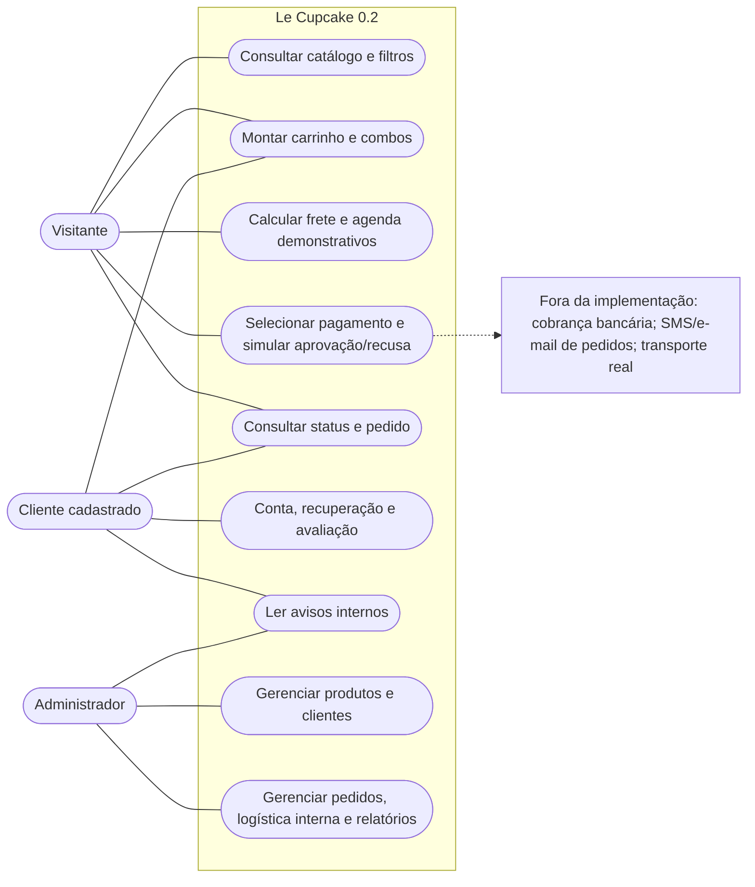

# Casos de uso — versão 0.2 (fronteiras reais)

Atores: visitante, cliente cadastrado e administrador. Os serviços externos NÃO estão integrados.

A ligação pontilhada indica **ausência de integração**. Esta representação complementa os diagramas formais de domínio e não declara atendimento integral dos requisitos de desempenho.
