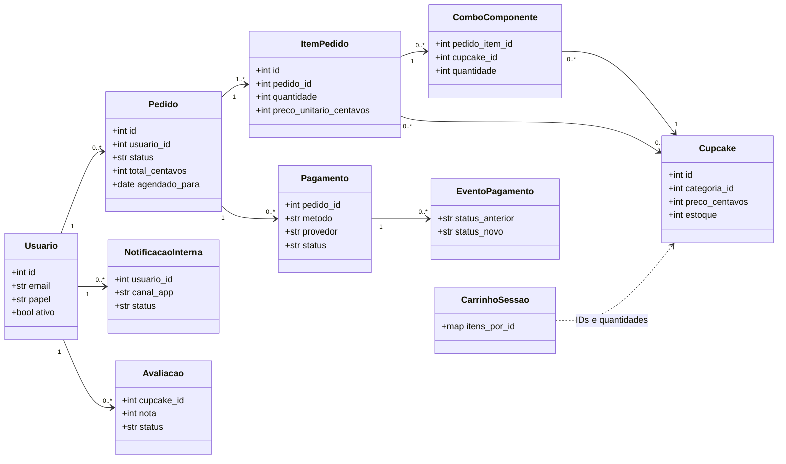

# Classes de domínio — versão 0.2

O diagrama é uma abstração do domínio; as colunas exatas estão no banco físico. O carrinho é guardado em **sessão**, embora tabelas não utilizadas de carrinho também existam no SQL inicial.

**Não há classe de gateway de pagamento conectado em produção.** `Pagamento` registra tentativa demonstrativa em `simulador_local`.
