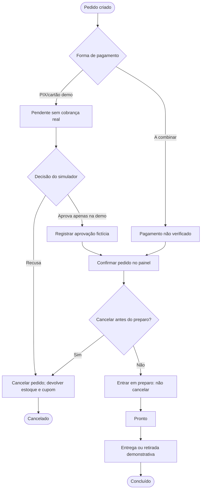

# Diagrama de atividades — pedido e pagamento demonstrativo

A decisão do simulador não prova autorização por um banco; a modalidade `a_combinar` não significa pagamento recebido. A regra do sistema bloqueia cancelamentos depois de entrar em preparo.
