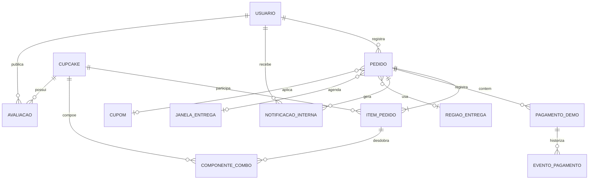

# Modelo conceitual — Le Cupcake 0.2

As cardinalidades ilustram o domínio. O físico completo contém 27 tabelas, algumas de apoio e outras de estrutura projetada que não são utilizadas por todos os fluxos.
