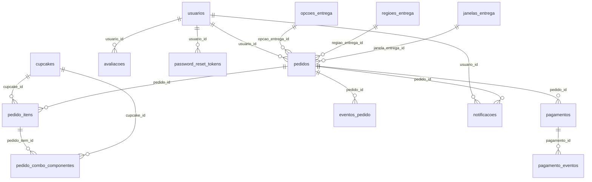

# Modelo lógico e físico — SQLite migrado

**Fonte verificável:** [schema.sql](../../schema.sql) + [migrations.py](../../migrations.py). O esquema-base possui **23 tabelas**. As migrações 1–7 adicionam quatro tabelas e campos/índices, produzindo **27 tabelas, 173 colunas, 34 FKs e 20 índices nomeados**.

## 27 tabelas físicas
```text
agenda_bloqueios      alergenos             auditoria
avaliacoes             carrinho_itens         carrinhos
categorias             combo_itens            combos
cupcake_alergenos      cupcakes               cupom_utilizacoes
cupons                 enderecos              estoque_movimentos
eventos_pedido         janelas_entrega        notificacoes
opcoes_entrega         pagamento_eventos      pagamentos
password_reset_tokens  pedido_combo_componentes
pedido_itens           pedidos                regioes_entrega
usuarios
```

O dicionário físico acadêmico foi extraído de `PRAGMA table_info`, `PRAGMA foreign_key_list`, `PRAGMA index_list` e `sqlite_master` de banco de teste migrado. **Não editar campos manualmente sem confrontar SQL efetivo.**

## Relações mais relevantes


## Distinções fundamentais
- As tabelas `carrinhos` e `carrinho_itens` existem, mas o carrinho operacional está na sessão assinada.
- `pagamentos.provedor=simulador_local` não significa integração bancária.
- `notificacoes.canal=app` não equivale a SMS/e-mail enviados.
- Índices e colunas acrescentados pelas migrações não constam integralmente do `schema.sql` base.
- Todos os preços são representados em centavos; valores de relatórios não são recebimentos financeiros reais.

O dicionário completo em Word e as vistas PNG/DOT foram gerados e renderizados no pacote do Ciclo F; homologação pública ainda pendente.
