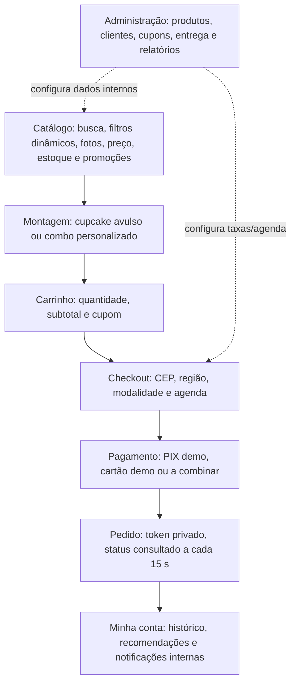

# Protótipos esquemáticos da interface — versão 0.2

**Não são capturas de tela testadas em navegador.** Estas são estruturas e fluxos para conferência de IHC; a identidade visual existente (verde-sálvia, terracota e creme) deve ser preservada.

**Mensagens exigidas pela IHC:** estoque insuficiente, CEP não atendido, horário indisponível, cupom inválido, bloqueio de cancelamento em preparo, link de redefinição indisponível sem SMTP, pagamento sem cobrança real.

**Limitação:** não houve homologação visual de todas as telas em navegador real neste ciclo. As fotos/licenças também devem ser conferidas na versão publicada.
